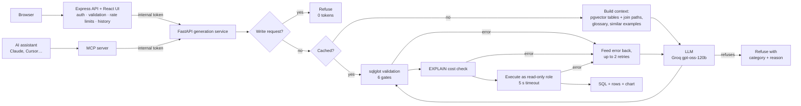

# Natural-Language Analytics Engine (Text-to-SQL)


Ask questions about a business database in plain English, and get back correct, safe SQL, its results, and a chart.

**Live demo: [textsql-3oa5.onrender.com](https://textsql-3oa5.onrender.com)**: click *Continue as guest*.
It runs on free hosting that sleeps when idle, so the first visit after a quiet period shows a short "waking up" message (about a minute).

The project focuses on what makes text-to-SQL reliable in production, not just on calling an LLM:
- **Layered safety,** so generated SQL can never modify data or run away with resources.
- **Retrieval** of relevant tables, business definitions and worked examples.
- **Self-correction** from database errors, and **explicit refusal** of questions it shouldn't answer.
- **Evaluation:** a development benchmark, an ablation of every phase, and a frozen held-out test set.
- **Production concerns:** answer caching, tracing, rate limits, a daily cost budget, automated tests and CI, a live deployment, and an MCP server for AI assistants.

> **Status:** Phases 1–11 and 13 complete; load testing (12) and final documentation (14) in progress. See [Roadmap](#roadmap).

---

## Results

Full details in [`evals/RESULTS.md`](evals/RESULTS.md).

**Held-out test set:** 20 questions, written after development and frozen before its first run.

| Core SQL | Business language | Refusals |
|---|---|---|
| **10/10** | **3/6** | **4/4** |

**Development set:** 68 questions, measured after each phase.

| Run | Core (50) | Business (10) | Refusals (8) | Avg latency | What changed |
|---|---|---|---|---|---|
| baseline | 48/50 | 2/10 | 0/8 | 691 ms | Full schema in prompt |
| gates | 48/50 | 2/10 | 0/8 | — | + 6 validation gates, cost check (**no accuracy loss**) |
| retry | 49/50 | 2/10 | 0/8 | 711 ms | + self-correcting retry loop |
| retrieval | pending | pending | pending | pending | + table descriptions, pgvector schema retrieval |
| semantic | 50/50 | **10/10** | 0/8 | 731 ms | + business glossary, few-shot examples |
| refusal | **50/50** | **10/10** | **8/8** | 723 ms | + intent check and model refusal (**0 false refusals**) |

**Why two test sets:** every development change was checked against the development set, so its 100% shows the system does what it was built to do. The held-out set measures how that carries over to unseen questions:
- **Core SQL and refusal carry over fully.**
- **Business terms only partly,** because the glossary matches phrases, not meanings.
- Of the three held-out failures, one is a genuine error ("stopped renting" read as "never rented"), one is a refusal of an undefined term, and one is a correct answer on a different scale (a fraction where the reference used a percentage).

**Also measured:**
- **Schema retrieval recall:** 60/60. Every question receives every table it needs, with ~5 of 15 tables per prompt.
- **178 automated tests:** 154 Python (including an 18-case SQL attack suite), 11 API, 8 UI and 5 MCP, all run by CI on every push.

---

## How it works



1. **The intent check:** requests that start with a write verb ("Delete…", "Drop…") are refused immediately: no LLM call, zero tokens.
2. **The cache:** a question answered before skips the LLM. Its stored SQL is **re-validated and re-run**, so results are never stale.
3. **Context:**
   - The question is embedded locally, and pgvector finds the most relevant tables; join paths are added through the foreign-key graph.
   - Business terms are matched to the company glossary.
   - The 3 most similar worked examples are added as patterns.
4. **Generation:** the model returns structured JSON with either SQL, or a refusal with a category and a reason.
5. **Safety:** six validation gates, then an `EXPLAIN` cost check. Nothing reaches the database unless both pass.
6. **Execution:** a read-only role, a 5-second timeout, results capped and flagged if truncated.
7. **Self-correction:** a failing query's error goes back to the model for up to two more attempts.
8. **Observability:** every request is logged (status, failing stage, attempts, tokens, latency, cache hit) and, optionally, traced in Langfuse step by step.

---

## Safety: defence in depth

| Layer | What it stops |
|---|---|
| **Intent check** | Requests to change data, before any LLM call |
| **Model refusal** | Questions about data that doesn't exist, predictions, off-topic requests |
| **Validation** (sqlglot syntax tree) | Anything but a single `SELECT`; writes, DDL, `SELECT INTO`, row locking, writes hidden in CTEs; dangerous functions; unknown tables; system catalogs. Adds a `LIMIT`. |
| **Cost check** | Runaway queries such as accidental cross joins, rejected from the `EXPLAIN` estimate |
| **Read-only role** | Any write that gets past every check above; credential columns aren't readable at all |
| **Statement timeout** | Anything still running after 5 seconds |

**Least privilege, with three database roles:**
- **`reader`** runs generated SQL and can only read the 15 business tables.
- **`app_user`** owns the request log and vector indexes.
- **`api_user`** can only read and write accounts and query history.

The database's admin account is never used by the running application.

**Protection for the public deployment:**
- per-user and per-IP rate limits;
- a daily LLM token budget (half the provider's allowance);
- a 500-character question limit;
- an internal token, so only the API and the MCP server can call the generation service;
- encrypted database connections, with certificate verification from Express.

---

## Deployment

| Part | Where | Notes |
|---|---|---|
| Express API + React UI | Render (free web service, Singapore) | One address: Express serves the built UI, so no CORS is needed |
| FastAPI generation service | Render (free web service, Singapore) | The embedding model is downloaded at build time, so a waking instance only loads it |
| PostgreSQL + pgvector | Neon (free, Singapore) | Loaded with the same setup scripts as local development (`scripts/setup_hosted_db.sh`) |
| Answer cache | Upstash Redis (free) | Encrypted connection; the app keeps working if the cache is unavailable |
| Tracing | Langfuse Cloud | Optional; only summaries are sent, never result rows |

**Infrastructure as code:** both services are defined in [`render.yaml`](render.yaml), a Render Blueprint.
- Secrets are never stored in the file: Render asks for them, or generates them (the internal token and the JWT secret).
- Every push to `main` redeploys automatically.

**Free-tier trade-offs, chosen knowingly:**
- **Services sleep after 15 minutes idle.** The UI wakes the generation service as soon as a visitor opens it, and shows a "waking up" message.
- **The generation service uses ~360 MB of the 512 MB available,** measured; memory settings keep it lower.

---

## Tech stack

| Area | Technology |
|---|---|
| Generation service | Python, FastAPI, Pydantic, async psycopg 3 with connection pools |
| LLM | Groq API (`openai/gpt-oss-120b`) via the OpenAI-compatible SDK, so the provider can be switched by configuration |
| Retrieval | pgvector, fastembed (`BAAI/bge-small-en-v1.5`, local CPU), YAML business glossary |
| SQL safety | sqlglot, PostgreSQL roles and column-level grants, `EXPLAIN` |
| Caching and tracing | Redis (Upstash in production), Langfuse |
| API | Node.js, Express 5, Zod, JWT, bcrypt, express-rate-limit, helmet, pino |
| UI | React 19, Vite, Tailwind CSS v4, TanStack Query, Recharts |
| AI-assistant access | MCP Python SDK (v2) |
| Database | PostgreSQL 18 + pgvector (Docker locally, Neon in production); Pagila sample data |
| Testing and CI | pytest, Vitest + Supertest, GitHub Actions; custom evaluation harness |
| Hosting | Render (Blueprint), Neon, Upstash |

---

## Repository structure

```
textTosql/
├── docker-compose.yml          # local PostgreSQL 18 + pgvector, and Redis
├── render.yaml                 # deployment blueprint for both services
├── .github/workflows/          # ci.yml (every push), accuracy.yml (manual accuracy gate)
├── db/
│   ├── init/                   # first start: Pagila, 3 roles, app tables
│   ├── schema.json             # extracted structure (scripts/dump_schema.py)
│   ├── schema_docs.yaml        # table and column descriptions
│   ├── semantic_layer.yaml     # business glossary (14 terms)
│   └── examples.jsonl          # 20 worked examples (none copy a test question)
├── gen-service/                # FastAPI: the text-to-SQL engine
│   ├── app/                    # main, pipeline, guard, cache, tracing, retrieval, semantic, prompt, llm, validate, db, config
│   └── tests/                  # 154 tests
├── api/                        # Express API (also serves the built UI in production); 11 tests
├── web/                        # React UI; 8 tests
├── mcp-server/                 # MCP server for AI assistants; 5 tests
├── evals/
│   ├── dataset.jsonl           # development set (68)
│   ├── holdout.jsonl           # held-out set (20)
│   ├── check_dataset.py        # verifies reference SQL
│   ├── run_eval.py             # accuracy evaluation (--dataset, --min-accuracy for CI)
│   ├── retrieval_recall.py     # retrieval recall (no LLM tokens)
│   ├── RESULTS.md
│   └── results/
└── scripts/                    # dump_schema.py, build_indexes.py, setup_hosted_db.sh, ask.sh
```

---

## Getting started (local)

**Prerequisites:** Docker, Python 3.11+, Node 20+, and an API key for Groq (or another OpenAI-compatible provider).

```bash
# 1. Configuration: copy the template, then set passwords, a 32+ character JWT_SECRET and your LLM key
cp .env.example .env

# 2. Database and Redis: Pagila, roles and app tables are created automatically on first start
docker compose up -d

# 3. Generation service
python3 -m venv .venv && source .venv/bin/activate
pip install -r gen-service/requirements-dev.txt python-dotenv
python scripts/build_indexes.py              # embeds tables and examples (downloads a 67 MB model once)
cd gen-service && uvicorn app.main:app --reload --port 8000

# 4. API (new terminal)
cd api && npm ci && npm run dev               # http://localhost:4000

# 5. UI (new terminal)
cd web && npm ci && npm run dev               # http://localhost:5173
```

**Tests and evaluations:**
```bash
cd gen-service && pytest -q                                          # 154 tests
cd api && npm test                                                   # 11 tests
cd web && npm test                                                   # 8 tests
cd mcp-server && python -m pytest -q                                 # 5 tests
python evals/check_dataset.py                                        # verify reference SQL
python evals/retrieval_recall.py                                     # retrieval recall (no LLM)
python evals/run_eval.py --label my_run --sleep 12                   # development set
python evals/run_eval.py --dataset evals/holdout.jsonl --label x     # held-out set
```

**MCP server:** `python mcp-server/smoke_test.py` starts it the way an AI assistant would, lists its tools and calls them.

### Configuration
Every setting is listed and explained in [`.env.example`](.env.example). The main groups:

| Settings | Purpose |
|---|---|
| `POSTGRES_*`, `READER_PASSWORD`, `APP_USER_PASSWORD`, `API_USER_PASSWORD` | Database and the three least-privilege roles |
| `DB_HOST`, `DB_PORT`, `DB_SSLMODE` (Python), `DB_SSL` (Express) | Where the database is, and whether connections must be encrypted |
| `LLM_API_KEY`, `LLM_BASE_URL`, `LLM_MODEL`, `LLM_REASONING_EFFORT` | Any OpenAI-compatible provider |
| `JWT_SECRET`, `CORS_ORIGIN`, `TRUST_PROXY`, `SERVE_WEB`, `QUERY_RATE_LIMIT_PER_HOUR` | The Express API |
| `INTERNAL_API_TOKEN`, `DAILY_TOKEN_BUDGET` | Protection for a deployed generation service |
| `REDIS_URL` | Answer cache (empty disables it) |
| `LANGFUSE_PUBLIC_KEY`, `LANGFUSE_SECRET_KEY`, `LANGFUSE_HOST` | Tracing (empty keys disable it) |

---

## Design decisions

- **Evaluation first, and honestly.** The benchmark came before any optimisation; each phase was measured; a held-out set written afterwards measures generalisation and was frozen in git before its first run.
- **Measure components separately.** A retrieval-recall check exposed a bug the accuracy evaluation never could: a partitioned table's foreign keys were lost during schema extraction, and the model had been silently guessing those joins.
- **Refuse rather than guess, but never refuse too eagerly.** False refusals are tracked alongside the refusal rate. The intent check only matches write verbs at the start of a request, so "How many rentals were updated?" is still answered.
- **Cache the SQL, not the results.** A cache hit skips the LLM but still re-validates and re-runs the query, so answers are never stale and safety is never bypassed. A fingerprint of the prompt, schema, glossary, examples and model invalidates old entries automatically.
- **One guarded front door.** The web API and the MCP server are both thin clients of the generation service, so every caller, human or AI agent, passes through the same safety layers, budget and logs.
- **Optional dependencies fail open, safety fails closed.** If Redis or Langfuse is unavailable, the app keeps working without them. If validation, the cost check or the database refuses a query, the query never runs.
- **The glossary is matched by phrase, deliberately:** a definition applied to the wrong question changes the answer, so matching must be precise and testable. The held-out set measured the cost of that choice (3/6 on unlisted phrasings).
- **Provider-independent.** Moving from Gemini (a free tier of 20 requests a day) to Groq took three configuration lines.

## Known limitations
- **Business terms only match listed phrasings;** "stopped renting" was misread as "never rented" on the held-out set.
- **An undefined term is refused** rather than clarified with a question.
- **One schema, self-written test sets.** Pagila is a well-known public sample database and likely appears in model training data, so accuracy on a private, messier schema would probably be lower.
- **Free hosting sleeps when idle;** the first request after a quiet period waits about a minute.
- **The token is stored in `localStorage`;** an httpOnly cookie would be more robust against XSS.
- **The model's self-reported `confidence` is not calibrated.**

**Next steps:**
- Match glossary terms by meaning (embeddings), and ask clarifying questions for undefined terms.
- Measure on a BIRD benchmark database, which is real-world and less likely to be memorised, using the existing harness (`--dataset`).

---

## Roadmap

| Phase | Feature | Status |
|---|---|---|
| 1 | Evaluation benchmark and harness | ✅ |
| 2 | sqlglot safety gates, cost check, attack test suite | ✅ |
| 3 | Self-correcting retry loop, request log | ✅ |
| 4 | Table descriptions, pgvector schema retrieval | ✅ (accuracy run pending) |
| 5 | Semantic layer (business glossary), few-shot examples | ✅ |
| 6 | Explicit refusal (intent check + model refusal) | ✅ |
| 7 | Express API: JWT and guest auth, Zod, rate limits, history | ✅ |
| 8 | React UI: SQL view, auto-charts, history, feedback | ✅ |
| — | Held-out evaluation | ✅ |
| 9 | Redis answer cache, Langfuse tracing | ✅ |
| 10 | API, UI and MCP tests; GitHub Actions CI; manual accuracy gate | ✅ |
| 11 | Deployment: Render Blueprint, Neon, Upstash | ✅ |
| 12 | Load testing (k6) | ⏳ |
| 13 | MCP server | ✅ |
| 14 | Demo video, final documentation | ⏳ |