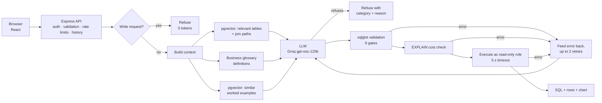

# Natural-Language Analytics Engine (Text-to-SQL)


Ask questions about a business database in plain English, and get back correct, safe SQL, its results, and a chart.

The project focuses on what makes text-to-SQL reliable in production, not just on calling an LLM:
- **Layered safety,** so generated SQL can never modify data or run away with resources.
- **Retrieval** of relevant tables, business definitions and worked examples.
- **Self-correction** from database errors.
- **Explicit refusal** of questions it shouldn't answer.
- **Evaluation:** a development benchmark, an ablation of every phase, and a frozen held-out test set.

> **Status:** in progress (Phase 8 of 14). The engine, the Express API and the React UI are complete. See [Roadmap](#roadmap).

---

## Results

Full details in [`evals/RESULTS.md`](evals/RESULTS.md).

**Held-out test set:** 20 questions, written after development and frozen before its first run.

| Core SQL | Business language | Refusals |
|---|---|---|
| **10/10** | **3/6** | **4/4** |

**Development set:** 68 questions, measured after each phase.

| Run | Core (50) | Business (10) | Refusals (8) | Avg latency | What changed |
|---|---|---|---|---|---|
| baseline | 48/50 | 2/10 | 0/8 | 691 ms | Full schema in prompt |
| gates | 48/50 | 2/10 | 0/8 | — | + 6 validation gates, cost check (**no accuracy loss**) |
| retry | 49/50 | 2/10 | 0/8 | 711 ms | + self-correcting retry loop |
| semantic | 50/50 | **10/10** | 0/8 | 731 ms | + retrieval, descriptions, business glossary, few-shot examples |
| refusal | **50/50** | **10/10** | **8/8** | 723 ms | + intent check and model refusal (**0 false refusals**) |

**Why two test sets:** every development change was checked against the development set, so its 100% shows the system does what it was built to do. The held-out set measures how well that carries over to questions it has never seen:
- **Core SQL and refusal carry over fully.**
- **Business terms only partly,** because the glossary matches phrases, not meanings. Of the three held-out failures, one is a genuine error ("stopped renting" read as "never rented"), one is a refusal of an undefined term, and one is a correct answer on a different scale (a fraction where the reference used a percentage).

**Also measured:**
- **Schema retrieval recall:** 60/60. Every question receives every table it needs, with ~5 of 15 tables per prompt.
- **148 automated Python tests,** including an 18-case SQL attack suite.

---

## How it works



1. **The intent check:** requests that start with a write verb ("Delete…", "Drop…") are refused immediately: no LLM call, zero tokens.
2. **Context:**
   - The question is embedded locally. pgvector finds the most relevant tables, and their join paths are added through the foreign-key graph.
   - Business terms ("VIP customer", "churned") are matched to the company glossary, and their definitions and tables are added.
   - The 3 most similar worked examples are added as patterns.
3. **Generation:** the model returns structured JSON with either SQL, or a refusal with a category and a reason.
4. **Safety:** six validation gates, then an `EXPLAIN` cost check. Nothing reaches the database unless both pass.
5. **Execution:** a read-only role, a 5-second timeout, results capped and flagged if truncated.
6. **Self-correction:** a failing query's error goes back to the model for up to two more attempts.
7. **Logging:** every request is recorded: status, failing stage, attempts, tokens, latency, cost.

---

## Safety: defence in depth

| Layer | What it stops |
|---|---|
| **Intent check** | Requests to change data, before any LLM call |
| **Model refusal** | Questions about data that doesn't exist, predictions, off-topic requests |
| **Validation** (sqlglot syntax tree) | Anything but a single `SELECT`; writes, DDL, `SELECT INTO`, row locking, writes hidden in CTEs; dangerous functions; unknown tables; system catalogs. Adds a `LIMIT`. |
| **Cost check** | Runaway queries such as accidental cross joins, rejected from the `EXPLAIN` estimate |
| **Read-only role** | Any write that gets past every check above; credential columns aren't readable at all |
| **Statement timeout** | Anything still running after 5 seconds |

**Least privilege, with three database roles:**
- **`reader`** runs generated SQL and can only read the 15 business tables.
- **`app_user`** owns the request log and vector indexes.
- **`api_user`** can only read and write accounts and query history.

**Cost protection for deployment:** per-user and per-IP rate limits, a daily LLM token budget, a 500-character question limit, and an internal token so only the API can call the generation service.

---

## Tech stack

| Area | Technology |
|---|---|
| Generation service | Python, FastAPI, Pydantic, async psycopg 3 with connection pools |
| LLM | Groq API (`openai/gpt-oss-120b`) via the OpenAI-compatible SDK, so the provider can be switched by configuration |
| Retrieval | pgvector, fastembed (`BAAI/bge-small-en-v1.5`, local CPU), YAML business glossary |
| SQL safety | sqlglot, PostgreSQL roles and column-level grants, `EXPLAIN` |
| API | Node.js, Express 5, Zod, JWT, bcrypt, express-rate-limit, helmet, pino |
| UI | React 19, Vite, Tailwind CSS v4, TanStack Query, Recharts |
| Database | PostgreSQL 18 + pgvector in Docker; Pagila sample data |
| Testing and evaluation | pytest (148 tests); custom harness with execution accuracy, ablation and a held-out set |

---

## Repository structure

```
textTosql/
├── docker-compose.yml          # PostgreSQL 18 + pgvector
├── db/
│   ├── init/                   # first start: Pagila, 3 roles, app tables
│   ├── schema.json             # extracted structure (scripts/dump_schema.py)
│   ├── schema_docs.yaml        # table and column descriptions
│   ├── semantic_layer.yaml     # business glossary (14 terms)
│   └── examples.jsonl          # 20 worked examples (none copy a test question)
├── gen-service/                # FastAPI: the text-to-SQL engine
│   ├── app/                    # main, pipeline, guard, retrieval, semantic, prompt, llm, validate, db, config
│   └── tests/                  # 148 tests
├── api/                        # Express API: auth, validation, rate limits, history
├── web/                        # React UI
├── evals/
│   ├── dataset.jsonl           # development set (68)
│   ├── holdout.jsonl           # held-out set (20)
│   ├── check_dataset.py        # verifies reference SQL
│   ├── run_eval.py             # accuracy evaluation
│   ├── retrieval_recall.py     # retrieval recall (no LLM tokens)
│   ├── RESULTS.md
│   └── results/
└── scripts/                    # dump_schema.py, build_indexes.py, ask.sh
```

---

## Getting started

**Prerequisites:** Docker, Python 3.11+, Node 20+, and an API key for Groq (or another OpenAI-compatible provider).

```bash
# 1. Configuration: copy the template, set real passwords, a 32+ character JWT_SECRET and your LLM key
cp .env.example .env

# 2. Database: Pagila, roles and app tables are created automatically on first start
docker compose up -d

# 3. Generation service
python3 -m venv .venv && source .venv/bin/activate
pip install -r gen-service/requirements-dev.txt python-dotenv
python scripts/build_indexes.py              # embeds tables and examples (downloads a 67 MB model once)
cd gen-service && uvicorn app.main:app --port 8000

# 4. API (new terminal)
cd api && npm ci && npm run dev               # http://localhost:4000

# 5. UI (new terminal)
cd web && npm ci && npm run dev               # http://localhost:5173
```

**Tests and evaluations:**
```bash
cd gen-service && pytest -q                                          # 148 tests
python evals/check_dataset.py                                        # verify reference SQL
python evals/retrieval_recall.py                                     # retrieval recall (no LLM)
python evals/run_eval.py --label my_run --sleep 12                   # development set
python evals/run_eval.py --dataset evals/holdout.jsonl --label x     # held-out set
```

### Configuration (`.env`)
| Variable | Purpose |
|---|---|
| `POSTGRES_USER`, `POSTGRES_PASSWORD`, `POSTGRES_DB` | Database admin and name |
| `READER_PASSWORD`, `APP_USER_PASSWORD`, `API_USER_PASSWORD` | The three least-privilege roles |
| `LLM_API_KEY`, `LLM_BASE_URL`, `LLM_MODEL`, `LLM_REASONING_EFFORT` | Any OpenAI-compatible provider |
| `JWT_SECRET` | Signs login tokens (32+ characters) |
| `INTERNAL_API_TOKEN` | Optional: only callers with this token may use the generation service |
| `DAILY_TOKEN_BUDGET` | Optional: stop answering after this many LLM tokens per day |
| `RETRIEVAL_TOP_K`, `FEW_SHOT_K`, `SCHEMA_RETRIEVAL` | Optional retrieval tuning |

---

## Design decisions

- **Evaluation first, and honestly.** The benchmark came before any optimisation; each phase was measured; a held-out set written afterwards measures generalisation and was frozen in git before its first run.
- **Measure components separately.** A retrieval-recall check exposed a bug the accuracy evaluation never could: a partitioned table's foreign keys were lost during schema extraction, and the model had been silently guessing those joins.
- **Refuse rather than guess, but never refuse too eagerly.** False refusals are tracked alongside the refusal rate. The intent check only matches write verbs at the start of a request, so "How many rentals were updated?" is still answered.
- **The glossary is matched by phrase, deliberately:** a definition applied to the wrong question changes the answer, so matching must be precise and testable. The held-out set measured the cost of that choice (3/6 on unlisted phrasings).
- **Retrieval is an accuracy and cost aid, not a security boundary.** Validation still allows all 15 business tables.
- **Provider-independent.** Moving from Gemini (a free tier of 20 requests a day) to Groq took three configuration lines.

## Known limitations
- **Business terms only match listed phrasings;** "stopped renting" was misread as "never rented" on the held-out set.
- **An undefined term is refused** rather than clarified with a question.
- **One schema, self-written test sets:** results don't show performance on other databases.
- **The token is stored in `localStorage`;** an httpOnly cookie would be more robust against XSS.
- **The model's self-reported `confidence` is not calibrated.**

---

## Roadmap

| Phase | Feature | Status |
|---|---|---|
| 1 | Evaluation benchmark and harness | ✅ |
| 2 | sqlglot safety gates, cost check, attack test suite | ✅ |
| 3 | Self-correcting retry loop, request log | ✅ |
| 4 | Table descriptions, pgvector schema retrieval | ✅ (accuracy run pending) |
| 5 | Semantic layer (business glossary), few-shot examples | ✅ |
| 6 | Explicit refusal (intent check + model refusal) | ✅ |
| 7 | Express API: JWT and guest auth, Zod, rate limits, history | ✅ |
| 8 | React UI: SQL view, auto-charts, history, feedback | ✅ |
| — | Held-out evaluation | ✅ |
| 9 | Redis caching, Langfuse tracing | ⏳ |
| 10 | API and UI tests, GitHub Actions CI with an accuracy gate | ⏳ |
| 11 | Deployment | ⏳ |
| 12 | Load testing (k6) | ⏳ |
| 13 | MCP server | ⏳ |
| 14 | Demo video, final documentation | ⏳ |